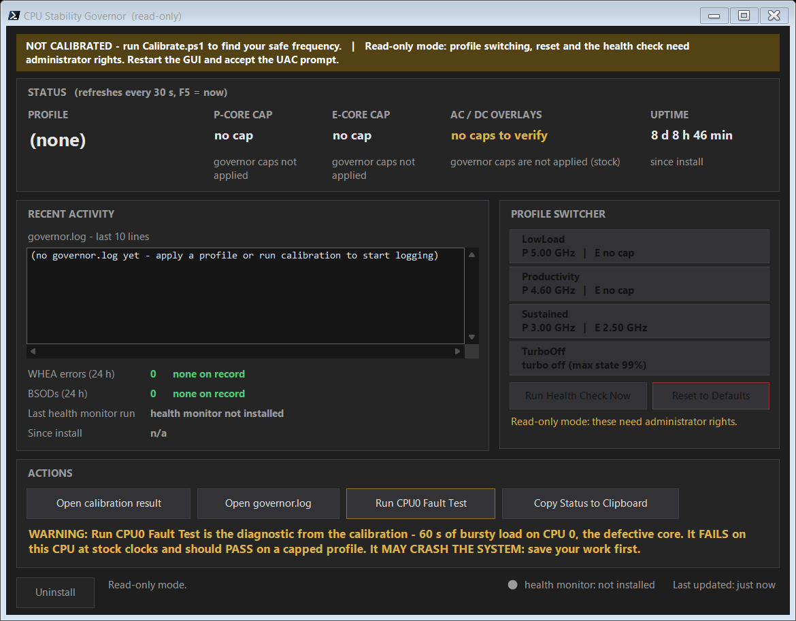

# CPU Governor

A frequency governor for Windows laptops experiencing blue screens, freezes,
or random crashes when running kernel-level anti-cheat systems.

## The Problem

Certain kernel-level anti-cheat systems — Riot Vanguard (used by VALORANT and
League of Legends), PUBG's Zakynthos anti-cheat, and a few others — hammer the
CPU with heavy kernel activity and rapid frequency transitions during gameplay
and background scanning.

On Intel 13th and 14th generation processors (Raptor Lake-HX family), this
activity can trigger a hardware-level fault inside the CPU. Windows reports it
as one of several blue screen errors: `PAGE_FAULT_IN_NONPAGED_AREA`,
`SYSTEM_SERVICE_EXCEPTION`, `IRQL_NOT_LESS_OR_EQUAL`, or others. The failing
module is often `vgk.sys`, `ntkrnlmp.exe`, or `ndis.sys`.

The problem is not the anti-cheat. The problem is the CPU: at its highest boost
frequencies, some units of this processor family produce incorrect results
internally, corrupting their own data.

## The Solution

Cap the CPU's maximum frequency below the unstable range. The crashes stop.
Games run normally. Anti-cheat systems continue to work without issue.

This governor sets a maximum frequency limit through Windows' built-in power
settings. The cap persists across reboots because Windows enforces it
automatically. There are no kernel drivers, no required background processes,
and no modifications to system files.

## How It Works

Open the GUI, choose a profile, close the window. The cap stays applied.

| Profile | P-core cap | Use case |
|---|---|---|
| LowLoad | ~4.9 GHz | Light use, after 2+ clean weeks |
| Productivity | ~4.5 GHz | Daily driver — recommended starting point |
| Sustained | ~3.0 GHz | Long sessions, high ambient temperatures |
| TurboOff | ~2.1 GHz | Last resort if other profiles still crash |

Run `Calibrate.ps1` once to test your specific CPU and recommend the highest
stable frequency for your unit.

## Install

1. Download this repo (green **Code** button → **Download ZIP**), then extract.
2. Right-click `Setup.ps1` → **Run with PowerShell**.
3. Follow the prompts:
   - First: choose whether to run calibration now (recommended).
   - Second: choose whether to install the optional health monitor.
4. Open **CPU Governor** from the Start Menu.

Requires PowerShell 7. If you don't have it, Setup will point you to
`winget install Microsoft.PowerShell`.

## Using It

Open **CPU Governor** from the Start Menu. Click a profile to apply it. Close
the window when done. The cap persists.

## Uninstall

Either method fully removes the governor and resets all power settings:

- Click the **Uninstall** button in the GUI.
- Run `Remove.ps1` from the release folder.

## What Calibration Does

Running `Calibrate.ps1` tests your CPU at descending frequency levels, checking
for hardware errors after each test. It produces one of three outcomes:

- **Healthy** — no errors at any frequency. No cap installed.
- **Degraded** — errors at some frequencies but not others. A safe cap is identified and applied.
- **Unrecoverable** — errors at every frequency. The tool cannot help; contact the manufacturer.

Calibration takes 30-60 minutes and can be re-run anytime.

## Known Limitations

- **Calibration is per-chip.** The bundled profile values are examples. Run `Calibrate.ps1` once after install.
- **The health monitor is optional.** By default, Setup installs only the frequency cap. Answer Y at the second prompt to add background error logging.
- **Requires PowerShell 7.**

## License

MIT — see LICENSE file.
